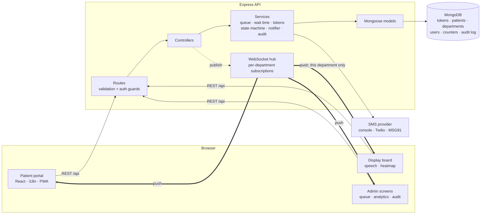
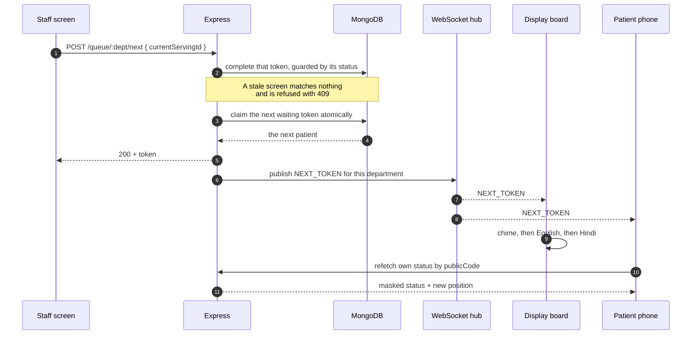
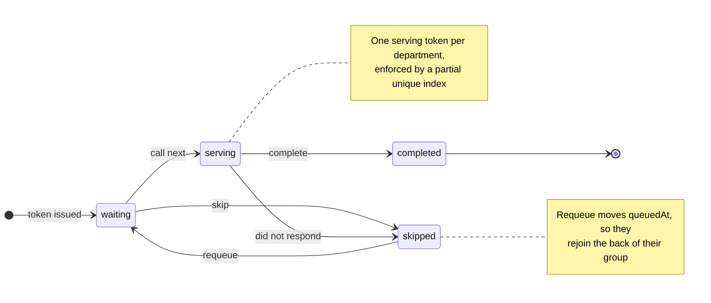

# 🏥 Hospital Queue & Token Management System

**A digital token queue for government hospital OPDs — patients take a token from their phone, follow their place in line in Hindi or English, and get an SMS when they are nearly up.**

Full-stack MERN: React 18 + Vite + Tailwind, Express 4 + Mongoose 8 + native WebSockets, MongoDB. 109 automated tests, Dockerised, documented with OpenAPI.

---

## The problem

In a government district hospital OPD, the queue is a physical line and a paper slip.

- **Nobody knows where they stand.** A patient who arrives at 9am cannot tell whether they will be seen at 10 or at 2, so they stand in the corridor for hours rather than risk losing their place.
- **Priority is informal.** A 78-year-old and a man with chest pain wait behind whoever queued first, unless a staff member happens to intervene.
- **The register is the only record.** When a patient is skipped, or one counter runs slow all morning, nothing is left afterwards to see it in.
- **Shouting is the notification system.** A name called once across a crowded hall is missed by anyone who stepped outside, or who does not hear well.

This replaces the paper slip with a token the patient follows from their own phone, makes the priority rules explicit and automatic, announces every call aloud in two languages, and keeps a record an administrator can actually read.

---

## Live demo

| | |
|---|---|
| **Patient portal** | `https://<your-vercel-app>.vercel.app` _← replace with your deployment_ |
| **Display board** | `https://<your-vercel-app>.vercel.app/display` |
| **Staff portal** | `https://<your-vercel-app>.vercel.app/admin/login` |
| **API docs** | [`/api/docs`](https://hospital-queue-management-system-66c6.onrender.com/api/docs) on the Render backend |

> **Demo credentials.** This project deliberately ships **no default password** — the first admin is created with whatever you set in `SEED_ADMIN_PASSWORD`, and that account must change it at first sign-in. If you publish a demo, put its throwaway password here (`admin@hospital.com` / `…`).
>
> The API runs on a free Render instance that sleeps when idle, so the first request after a quiet spell can take ~30 seconds to wake it.

---

## Screenshots

> _Placeholders — drop real captures into `docs/screenshots/`._

| Take a token | Follow the queue |
|---|---|
|  |  |

| Waiting-room display board | Staff queue management |
|---|---|
|  |  |

| Analytics | Audit log |
|---|---|
|  |  |

**A token being called, announced, and landing on every screen at once:**


---

## Features

### For patients
- **A token in three taps** — name, department, done. No account, no app to install.
- **Live position and an honest wait**, given as a range ("15–25 min") rather than false precision.
- **A QR code on every token**, linking to a private tracking page — wait outside and follow the queue from your phone.
- **An SMS when you are nearly up**, once per token, on reaching the front three.
- **Hindi and English**, switchable with one tap, down to the validation messages.
- **Installable** as a progressive web app, so the tracking page sits on the home screen.

### For staff
- **Call next, skip, complete, requeue, recall** and emergency insert — every action guarded against a stale screen.
- **A requeued patient rejoins the back of their priority group**, not their original place.
- **Department scoping** — staff tied to Cardiology cannot see or touch another department's queue.

### For the waiting room
- **A display board** with the serving token and the next five.
- **Spoken announcements** — a chime, then English, then Hindi, with a mute toggle.
- **A text-size control** (A / A+ / A++) for a board read from across the hall.

### For administrators
- **Analytics** — tokens per department per day, average wait, average consultation, a weekday × hour peak-hours heatmap, and skip rate over any date range.
- **An audit log** of every staff action, filterable by action, department, staff member and date.
- **Department configuration**, including how many counters run in parallel.

---

## Architecture



Requests flow **routes → controllers → services → models**; only services touch the database, and only controllers publish to the socket hub.

### How one call reaches every screen



**Real-time details**

- Clients subscribe per department (`{ type: 'SUBSCRIBE', departmentId }`), so a board in Cardiology is never woken by a token issued in OPD.
- A **30-second ping/pong heartbeat** drops connections that vanished without closing.
- **Auto-reconnect** with exponential backoff (1s → 2s → 4s … max 30s), re-sending every active subscription on reconnect.
- **Polling is the fallback, not the default** — 8s on the staff queue, 15s on the patient status page, and 3s on the display board only while the socket is down.

---

## How the queue works

### Priority

Every token carries a priority, assigned when the patient registers:

| Priority | Who | Assigned by |
|---|---|---|
| **3 · Emergency** | Critical patients inserted by staff | Explicit staff action |
| **2 · Senior citizen** | Age 60 and over | Derived from the age given at registration |
| **1 · Normal** | Everyone else | Default |

The queue is then a single sort, used by every screen and by "call next":

```
priority DESC,  queuedAt ASC
```

`queuedAt` is the arrival time — except for a patient who was skipped and put back, where it becomes the requeue time. That one field is why a requeued patient rejoins **the back of their own priority group** instead of jumping to their old slot, and why the rule needs no special cases anywhere else. An emergency insert goes straight to the front without touching anybody else's record.

### Wait-time estimation

One implementation in `services/queueService.js`, used by both the staff screens and the patient's own status page, so the two can never disagree.

**1 · What a consultation actually takes today** — an aggregation over today's completed consultations in that department:

```
avg( completedAt − calledAt )   for today's IST date
```

Durations under a minute (a mis-click) and over three times the department's configured average (a "complete" button nobody pressed until later) are trimmed out. Below three samples it falls back to the department's configured average.

**2 · What is left of the consultation in progress:**

```
max(1, avgTime − minutes since calledAt)
```

Measured from when the patient was really called, not the common shortcut of assuming half the average. A consultation running over reports one minute, never zero or a negative.

**3 · The queue ahead**, shared between the counters the department is running:

```
aheadCount × avgTime ÷ activeCounters
```

**4 · Reported as a range.** The band comes from how much that department's consultations actually vary — its standard deviation, scaled by the **square root** of the consultations that must finish first, because independent overruns and underruns partly cancel rather than stacking. Capped at ±50% so an estimate never becomes meaningless.

```
15–25 min
```

### Token numbers

`OPD-042` — department code plus a per-day sequence. The sequence restarts every IST day and comes from an atomic `$inc` on a per-department-per-day counter document, so twenty simultaneous registrations get twenty distinct numbers. Because the number repeats daily, uniqueness is enforced on `{ department, serviceDate, sequenceNumber }` — and the patient's own lookup key is a separate, unguessable 8-character `publicCode`.

### Queue state machine

The allowed transitions live in one place (`services/tokenState.js`). Every status write is a guarded update matching only the expected current state, so a stale screen changes nothing and is answered with `409 Conflict`.



### Patient notifications

A patient within `NOTIFY_AT_POSITION` (default 3) of the front gets one SMS, through a pluggable notifier.

| `SMS_PROVIDER` | Needs | Behaviour |
|---|---|---|
| `console` *(default)* | nothing | Writes the message to the log — no credentials, no cost, no accidental texts in development |
| `twilio` | `TWILIO_ACCOUNT_SID`, `TWILIO_AUTH_TOKEN`, `TWILIO_FROM` | Posts to the Twilio REST API; numbers normalised to E.164 (`+91…`) |
| `msg91` | `MSG91_AUTH_KEY`, `MSG91_TEMPLATE_ID` | Posts to the MSG91 flow API. Indian carriers only accept DLT-registered templates, so the wording lives in the MSG91 console and the code fills `token`, `position` and `department` |

`Token.notifiedAt` is claimed with a guarded update *before* the message is sent, so two simultaneous queue changes cannot both message the same patient — at-most-once by design, because a duplicate SMS is worse than a missing one. A provider selected without credentials falls back to `console` rather than failing the request, and the whole sweep runs in the background so a slow gateway never delays the staff member who pressed Call next.

---

## Setup

### With Docker

```bash
cp .env.example .env                              # set JWT_SECRET and SEED_ADMIN_PASSWORD
docker compose --profile setup run --rm setup     # indexes + first admin, once
docker compose up
```

| URL | What |
|---|---|
| `http://localhost:8080` | Patient portal, display board, admin screens |
| `http://localhost:5001/api/docs` | Interactive API documentation |

MongoDB runs as a **single-node replica set**, not a standalone: a patient and their token are written in one transaction where the deployment supports it, and a standalone `mongod` cannot. Compose initiates the set from its health check, so nothing starts against a half-ready database. nginx serves the built frontend and proxies `/api` and `/ws`, so the browser only ever talks to one origin.

### Locally

**Prerequisites:** Node.js ≥ 18 and a running MongoDB.

```bash
# Backend
cd backend
npm install
cp .env.example .env          # then set SEED_ADMIN_PASSWORD
npm run migrate:indexes       # once per database
npm run seed                  # departments + first admin
npm run dev                   # http://localhost:5001

# Frontend, in another terminal
cd frontend
npm install
npm run dev                   # http://localhost:3000
```

| URL | Purpose |
|---|---|
| `http://localhost:3000` | Patient — take a token, track the queue |
| `http://localhost:3000/display` | Waiting-room display board |
| `http://localhost:3000/admin/login` | Staff and admin portal |

> **On a standalone `mongod`** transactions are unavailable, so the app falls back to deleting the patient record if the token write fails. Both paths are covered by tests; Docker and Atlas get the transaction.

### Scripts

| Script | Where | What it does |
|---|---|---|
| `npm run seed` | backend | Idempotent — creates missing departments, and the admin only if none exists |
| `npm run seed:demo` | backend | ~20 realistic waiting patients, for screenshots. Refused in production |
| `npm run seed:reset` | backend | **Deletes everything**, then reseeds. Refused in production |
| `npm run migrate:indexes` | backend | One-off index migration, once per environment |
| `npm test` | root | Backend (Jest) then frontend (Vitest) |
| `npm run lint` | root | ESLint over both packages |

### Deploying (Vercel + Render)

`frontend/vercel.json` rewrites `/api/*` to the Render backend and sends every other path to `/index.html`, so deep links like `/track/<code>` survive a reload.

**Vercel rewrites do not proxy WebSockets**, so the live feed must reach Render directly — set `VITE_WS_URL=wss://<your-render-host>/ws` on the Vercel project. Without it the UI keeps working but silently degrades to polling. On Render set `MONGO_URI`, `JWT_SECRET`, `CLIENT_URL` (the Vercel origin) and `NODE_ENV=production`, then run `npm run migrate:indexes` once.

---

## Environment variables

### Backend (`backend/.env`)

| Variable | Default | What it does |
|---|---|---|
| `MONGO_URI` | — | **Required.** MongoDB connection string |
| `JWT_SECRET` | — | **Required.** Signs staff session tokens |
| `PORT` | `5001` | API port |
| `NODE_ENV` | `development` | `production` hides stack traces, masks 5xx messages and unregisters the demo token endpoint |
| `JWT_EXPIRES_IN` | `8h` | Session length |
| `CLIENT_URL` | — | Comma-separated browser origins allowed to call the API. Unset means no cross-origin browser call is accepted |
| `SEED_ADMIN_PASSWORD` | — | Password for the first admin. Seeding is refused without it; there is no default |
| `SEED_ADMIN_EMAIL` | `admin@hospital.com` | Email for the first admin |
| `AVG_CONSULTATION_TIME` | `10` | Fallback consultation time, in minutes |
| `SMS_PROVIDER` | `console` | `console`, `twilio` or `msg91` |
| `NOTIFY_AT_POSITION` | `3` | How near the front a patient must be to be messaged |
| `TWILIO_ACCOUNT_SID`<br/>`TWILIO_AUTH_TOKEN`<br/>`TWILIO_FROM` | — | Twilio credentials |
| `MSG91_AUTH_KEY`<br/>`MSG91_TEMPLATE_ID` | — | MSG91 credentials |
| `LOGIN_RATE_LIMIT_MAX`<br/>`LOGIN_RATE_LIMIT_WINDOW_MIN` | `10` / `15` | Sign-in throttle per IP |
| `TOKEN_RATE_LIMIT_MAX`<br/>`TOKEN_RATE_LIMIT_WINDOW_MIN` | `5` / `10` | Token-generation throttle per IP. Raise both for a shared kiosk, or a hospital behind one public IP |

### Frontend

| Variable | When you need it |
|---|---|
| `VITE_WS_URL` | **In production**, when the API is on another host — e.g. `wss://your-api.onrender.com/ws`. Baked in at build time |

### Docker (`.env` at the repository root)

`JWT_SECRET` and `SEED_ADMIN_PASSWORD` are required; `WEB_PORT`, `CLIENT_URL` and the tuning variables above are optional. See `.env.example`.

---

## API

Interactive documentation at **`/api/docs`** (Swagger UI); the raw OpenAPI 3 document at `/api/docs.json`.

| Method | Endpoint | Auth | Description |
|---|---|---|---|
| `GET` | `/api/health` | — | Liveness check |
| `POST` | `/api/auth/login` | — | Sign in *(rate limited)* |
| `GET` | `/api/auth/me` | JWT | The signed-in user |
| `POST` | `/api/auth/register` | Admin | Create a staff or admin account |
| `PATCH` | `/api/auth/change-password` | JWT | Rotate your own password |
| `GET` | `/api/departments` | — | List departments |
| `POST` · `PATCH` | `/api/departments[/:id]` | Admin | Create / update a department |
| `POST` | `/api/tokens/generate` | — | Take a token *(rate limited)* |
| `GET` | `/api/tokens/status/:publicCode` | — | A patient's own status, masked |
| `GET` | `/api/tokens/current/:deptId` | — | Who is being served |
| `GET` | `/api/queue/public/:deptId` | — | Display board feed |
| `GET` | `/api/queue/all` | JWT | Dashboard summary |
| `GET` | `/api/queue/:deptId` | JWT | Full queue, estimates, today's skipped |
| `POST` | `/api/queue/:deptId/next` | JWT | Call the next patient |
| `POST` | `/api/queue/:deptId/emergency` | JWT | Insert an emergency patient |
| `POST` | `/api/queue/:deptId/recall` | JWT | Re-announce the serving token |
| `POST` | `/api/queue/token/:id/skip` | JWT | Skip a patient |
| `POST` | `/api/queue/token/:id/complete` | JWT | Complete a consultation |
| `POST` | `/api/queue/token/:id/requeue` | JWT | Put a skipped patient back |
| `GET` | `/api/analytics/*` | Admin | Overview, tokens per day, peak hours, per-department |
| `GET` | `/api/audit` | Admin | Staff action log, filtered and paginated |

**WebSocket** at `/ws`. Subscribe with `{ "type": "SUBSCRIBE", "departmentId": "<id>" }`; events are `NEXT_TOKEN`, `TOKEN_SKIPPED`, `TOKEN_COMPLETED`, `TOKEN_REQUEUED`, `TOKEN_RECALLED`, `EMERGENCY_INSERT` and `NEW_TOKEN`.

---

## Testing

```bash
npm run install:all
npm run lint                 # ESLint over both packages
npm test                     # backend (Jest) then frontend (Vitest)
```

**109 tests — 79 backend across 12 suites, 30 frontend across 5.**

| Where | Stack | What it covers |
|---|---|---|
| `backend/tests` | Jest · supertest · mongodb-memory-server | Priority ordering · the IST daily sequence across midnight, with the clock faked · 20 concurrent registrations getting 20 distinct numbers · two simultaneous `callNext` calls leaving exactly one serving token · skip → requeue ordering · role enforcement · department scoping · what public endpoints expose · SMS notification rules · analytics aggregations · the audit log |
| `frontend/tests` | Vitest · React Testing Library | Dashboard · queue management · the patient token form · announcement text · language switching |

The backend suite starts its own **in-memory replica set** and needs no running MongoDB — a replica set rather than a standalone, so the Patient + Token transaction is genuinely exercised. It builds the real indexes first, because several guarantees (one serving token per department, one sequence number per department per day) are enforced by indexes rather than by code.

Offline, point it at a local binary instead of letting it download one:

```bash
MONGOMS_SYSTEM_BINARY=/path/to/mongod npm test
```

`.github/workflows/ci.yml` runs lint, tests and a frontend build on every push and pull request. Prettier config is checked in (`.prettierrc`, plus `frontend/.prettierrc` for the semicolon-free frontend style) with `npm run format` and `format:check` in each package; it has deliberately **not** been applied to the pre-existing code, so CI runs lint only.

---

## Security notes

| Area | What is done |
|---|---|
| **Authentication** | JWT bearer tokens. `protect` loads the user from the database on every request, so a disabled or deleted account loses access immediately rather than at token expiry |
| **Authorisation** | `requireRole('admin')` on registration, department writes, analytics and the audit log. Staff tied to a department cannot read or act on any other — enforced from the token's own department, never from the URL |
| **Passwords** | bcrypt at cost 12. No default password anywhere: the first admin's comes from `SEED_ADMIN_PASSWORD` and must be changed at first sign-in |
| **Patient privacy** | Public endpoints *and the WebSocket feed* return a masked name ("Rahul S.") and never age, phone or patient identifiers. A patient reads their status with an unguessable `publicCode`, never the guessable token number — the old lookup by token number answers `410 Gone` |
| **Input validation** | zod schemas on every `POST`/`PATCH` body and every `:id`, with unknown keys stripped, so a request cannot smuggle `priority` or `status` into a model |
| **Rate limiting** | Sign-in 10 per 15 min per IP; token generation 5 per 10 min. `trust proxy` is set, so limits key on the real client IP behind a proxy |
| **Transport & headers** | helmet, and CORS restricted to an explicit `CLIENT_URL` allow-list — no `origin: *`, and no cookie credentials, since auth is a bearer token |
| **Error handling** | Mongoose validation and cast errors map to `400`, duplicate keys to `409`. In production, 5xx messages are replaced and stack traces are never sent |
| **Accountability** | Every staff action is appended to an audit log with the user, token, department and timestamp. Nothing in the application edits or deletes an entry |
| **Concurrency** | Status changes are guarded updates; one serving token per department and one sequence number per department per day are enforced by **unique indexes**, not by hopeful application code |

---

## Roadmap

- [ ] **Counter assignment** — `activeCounters` already feeds the wait-time maths, but no token is tied to a specific desk, so announcements name the department rather than "counter 2". Needs a counter on the token at call time and a relaxed serving index.
- [ ] **Backfill `publicCode`** for tokens issued before it existed, so patients queued at deploy time keep their status page.
- [ ] **Scope the admin UI** to a staff member's department, so the picker never offers a queue they will be refused.
- [ ] **Tell a patient it is their turn** — today they get one SMS nearing the front, and nothing when actually called.
- [ ] **Per-department Hindi names**, so a Hindi screen stops reading "Out Patient Department" in English.
- [ ] **Printed token slips** for patients without a phone.
- [ ] **Appointment slots** alongside walk-ins.

---

## Project structure

```
hospital-queue-system/
├── backend/
│   ├── src/
│   │   ├── routes/          # HTTP surface: auth guards + validation
│   │   ├── controllers/     # request → service → response
│   │   ├── services/        # queue order, wait times, token issue, state
│   │   │                    # machine, notifier, audit, analytics
│   │   ├── models/          # Mongoose schemas and their indexes
│   │   ├── validators/      # zod schemas + the validate() middleware
│   │   ├── realtime/        # WebSocket hub, per-department subscriptions
│   │   ├── middleware/      # auth, error handling
│   │   ├── utils/           # IST dates, token generation, public views, seeders
│   │   └── docs/            # OpenAPI document
│   └── tests/               # Jest + supertest, in-memory replica set
├── frontend/
│   ├── src/
│   │   ├── pages/           # patient, display board, admin screens
│   │   ├── components/      # patient, admin and shared UI
│   │   ├── context/         # auth and the WebSocket provider
│   │   ├── locales/         # en / hi translations
│   │   └── utils/           # formatting, announcements, chart palette
│   └── tests/               # Vitest + React Testing Library
└── docker-compose.yml       # app + MongoDB replica set
```

---

## Tech stack

**Frontend** React 18 · Vite 5 · Tailwind CSS 3 · React Router 6 · react-i18next · recharts · vite-plugin-pwa
**Backend** Node.js · Express 4 · Mongoose 8 · ws · zod · helmet · JWT · bcrypt
**Database** MongoDB — aggregation pipelines, partial and compound unique indexes, transactions
**Tooling** Jest · supertest · mongodb-memory-server · Vitest · React Testing Library · ESLint 9 · Prettier · GitHub Actions · Docker Compose · OpenAPI 3
